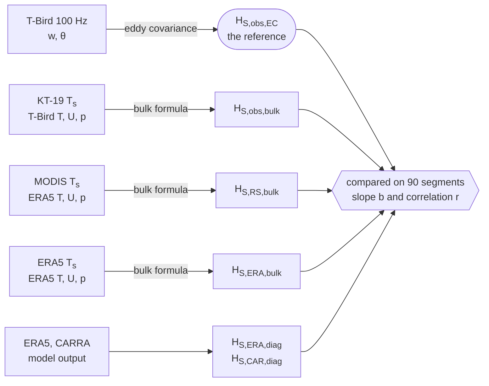

How well do reanalyses and satellite-based methods estimate the turbulent **sensible heat flux** over
Arctic sea ice? To find out, the flux was *measured* 20–30 m above the ice by eddy covariance, with a
sensor package (the T-Bird) towed below the research aircraft Polar 6 during the BACSAM-II campaign
(Svalbard, April 2024). This measurement is the reference against which bulk estimates driven by in-situ,
satellite and reanalysis inputs are judged.

This site accompanies the paper *Evaluation of reanalysis and satellite products of sensible heat flux
over Arctic sea ice against airborne eddy-covariance measurements* by J. J. Müller, I. Staudinger,
F. Gebhardt, D. J. Simon, L. Köhler, J. Hartmann, A. Ehrlich, M. Schäfer, M. D. Shupe and M. Wendisch
(submitted to *Atmospheric Measurement Techniques*), and the repository that reproduces every number,
table and figure of it from the shipped data.

## What is compared

Six estimates of the same flux on the same 90 flight segments of 5 km. Going down, measured inputs
are replaced step by step by products that are available everywhere, so whatever skill is lost can be
attributed to the input that was replaced.

## Three ways in

::::{grid} 1 1 3 3

:::{card} Understand the method
:link: ../book/01_overview.ipynb
Six short chapters that recompute the paper's central numbers step by step: one eddy-covariance
flux and one bulk flux by hand, the comparison, the sensitivity, and how robust it all is.
:::

:::{card} Reproduce every number
:link: reproduce.md
One command, `pixi run all`, rebuilds every number, table and figure and checks the numbers
against a committed reference.
:::

:::{card} Review the paper against the code
:link: paper_to_code.md
Where each section, equation, table and figure of the paper lives in the code, and a clean reading
copy of the manuscript annotated with it.
:::

::::

## The findings, and where to see them

1. **The surface temperature decides whether a bulk estimate follows the observed variability.**
   Driven by ERA5 alone, the bulk flux recovers only a small part of the observed amplitude; replacing the
   ERA5 surface temperature by the MODIS retrieval improves amplitude and correlation, and the gain sits on
   the segments with a heterogeneous surface. → [Chapter 4](../book/04_comparison.ipynb)
2. **With measured inputs the conventional transfer coefficient is too large.** The in-situ bulk estimate
   tracks the measurement best but overestimates its amplitude. The scalar roughness ratio αT
   rescales the amplitude and leaves the correlation untouched. → [Chapter 5](../book/05_sensitivity_and_uncertainty.ipynb)
3. **The stability scheme hardly matters** under the near-neutral spring conditions sampled.
   → [Chapter 3](../book/03_bulk_method.ipynb)

How far these statements carry, with only 90 segments on four flight days, is the subject of
[Chapter 6](../book/06_robustness.ipynb).
