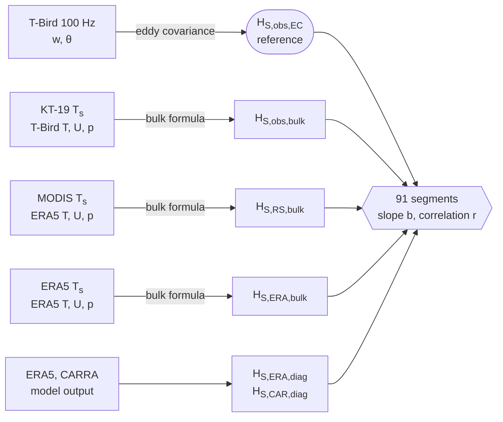

This site is the electronic supplement to *Evaluation of reanalysis and satellite products of sensible heat flux
over Arctic sea ice against airborne eddy-covariance measurements* by J. J. Müller, I. Staudinger, F. Gebhardt,
D. J. Simon, L. Köhler, J. Hartmann, A. Ehrlich, M. Schäfer, M. D. Shupe and M. Wendisch (submitted to
*Atmospheric Measurement Techniques*). It documents the method, the code that produces every number, table
and figure of the paper, and the data from which they are derived.

:::{figure} images/polar6_tbird.png
:alt: The research aircraft Polar 6 towing the T-Bird on a cable below it
:width: 75%
The research aircraft Polar 6 with the T-Bird, the towed sensor package that measured the reference flux. Drawing
generated with ChatGPT from a photograph by Anna-Maria Jörs.
:::

During the BACSAM-II campaign (Svalbard, April 2024), the T-Bird was towed 20–30 m above the sea ice and measured
wind and temperature at 100 Hz. The sensible heat flux derived from these data by eddy covariance is the reference
for bulk estimates driven by in-situ, satellite and reanalysis inputs.

## How to use this supplement

**To check the paper.** [Paper and code](paper_to_code.md) locates each section, equation, table and figure of the
paper in the code, and [Figures](figures/index.md) shows each figure with its caption and the script that draws it.
`pixi run check` recomputes every number printed in the paper from the data in the repository and compares it with the
committed reference; `pixi run all` also rebuilds the tables and figures ([Reproduction](reproduce.md)). Neither
requires programming knowledge.

**To reuse code or data.** The analysis package `fluxpy` (eddy covariance, bulk transfer, stability schemes,
uncertainty) is documented in the [API reference](api/index.md); the data files and their variables are described under
[Data files](data.md). The code is released under the MIT License; the subsets of third-party products remain under the
licences of their providers. Please cite the paper and the archived version of the repository (`CITATION.cff`).

**To follow the method.** The [Method](../book/01_overview.ipynb) chapters derive the eddy-covariance and the bulk flux
of a single segment by hand and recompute the central results of the paper; the [Glossary](glossary.md) defines the
symbols. No prior knowledge of the code is assumed.

## Flux estimates

Six estimates of the same flux are compared on the same 91 flight segments of 5 km. From top to bottom, measured inputs
are successively replaced by products with pan-Arctic coverage, so that a loss of skill can be attributed to the
replaced input.

## Contents

::::{grid} 1 2 3 3

:::{card} Method
:link: ../book/01_overview.ipynb
Five chapters that recompute the central numbers of the paper: the eddy-covariance and bulk flux of one segment, the
comparison, and sensitivity and uncertainty.
:::

:::{card} Figures
:link: figures/index.md
The eight figures of the paper with their captions, their construction and the scripts that produce them.
:::

:::{card} Reproduction
:link: reproduce.md
`pixi run all` recomputes every number, table and figure and compares the numbers with a committed reference.
:::

:::{card} Paper and code
:link: paper_to_code.md
The location of each section, equation, table and figure of the paper in the code, and an annotated copy of the
manuscript.
:::

:::{card} API reference
:link: api/index.md
Every module, constant, class and function of the analysis package `fluxpy`, and every script, generated from the
source code.
:::

::::

## Main results

1. **The surface temperature determines whether a bulk estimate follows the observed variability.** Driven by ERA5
   alone, the bulk flux recovers only a small part of the observed amplitude. Replacing the ERA5 surface temperature by
   the MODIS retrieval improves amplitude and correlation, mainly on segments with a heterogeneous surface.
   → [Chapter 4](../book/04_comparison.ipynb)
2. **With measured inputs, the conventional transfer coefficient is too large.** The in-situ bulk estimate has the
   highest correlation but overestimates the amplitude. The scalar roughness ratio αT rescales the amplitude
   without changing the correlation. → [Chapter 5](../book/05_sensitivity_and_uncertainty.ipynb)
3. **The choice of stability scheme is of minor importance** under the near-neutral spring conditions sampled.
   → [Chapter 3](../book/03_bulk_method.ipynb)

## Acknowledgements

We gratefully acknowledge the funding by the Deutsche Forschungsgemeinschaft (DFG, German Research Foundation) –
project no. 268020496 – TRR 172, within the Transregional Collaborative Research Center “ArctiC Amplification: Climate
Relevant Atmospheric and SurfaCe Processes, and Feedback Mechanisms (AC)³”.
